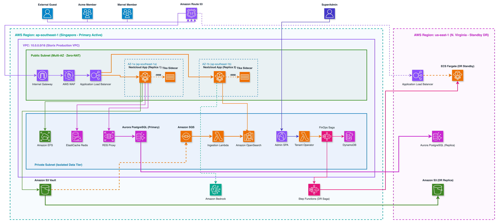
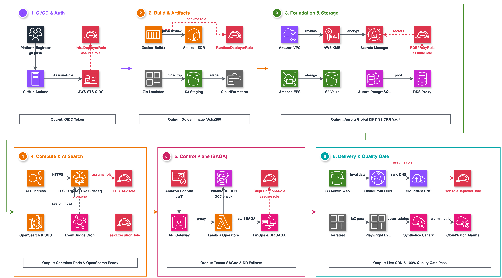
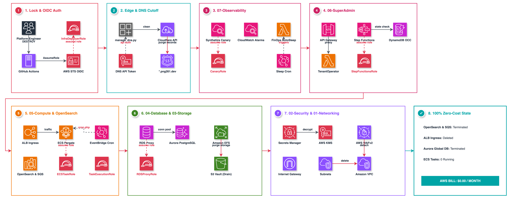

<p align="center">
  <picture>
    <source media="(prefers-color-scheme: dark)" srcset="docs/images/storix-logo-white.png">
    
  </picture>
</p>

# Storix Infrastructure & Operations

<p align="center">
  <a href="#-test-status--verification-matrix"></a>
  <a href="#-test-status--verification-matrix"></a>
  <a href="#-test-status--verification-matrix"></a>
  <a href="#-test-status--verification-matrix"></a>
  <a href="#-test-status--verification-matrix"></a>
  <a href="#-test-status--verification-matrix"></a>
  <a href="#-test-status--verification-matrix"></a>
</p>

<p align="center">
  <a href="#1-architecture-overview"><strong>Architecture</strong></a> ·
  <a href="#-test-status--verification-matrix"><strong>Scorecard</strong></a> ·
  <a href="#2-directory-layout"><strong>Directory Layout</strong></a> ·
  <a href="#3-deployment--teardown"><strong>Deployment</strong></a> ·
  <a href="#4-testing--verification"><strong>Testing</strong></a> ·
  <a href="#5-architecture-diagrams-as-code"><strong>Diagrams</strong></a> ·
  <a href="https://github.com/FilestoreCloud/docs"><strong>Documentation</strong></a>
</p>

---

Modular CloudFormation Infrastructure as Code (IaC), Step Functions SAGAs, and operational automation for the Storix enterprise multi-tenant platform on AWS.

---

## 📊 Test Status & Verification Matrix

| Test Suite | Framework / Tool | Tests | Scope & Assertions | Status |
|---|---|---|---|---|
| **E2E Invariants (Tiers 1–4)** | `pytest` / `unittest` | **167** | Cross-feature CloudFormation contracts, Step Functions SAGAs, private subnet isolation, zero unbound wildcard domains |  |
| **Control Plane Unit & Auth** | `unittest` | **15** | RBAC SuperAdmin vs Viewer, MFA TOTP, WebAuthn Passkeys, HttpOnly cookie extraction, fail-closed signing keys |  |
| **Async OCC Command Engine** | `unittest` | **4** | Async OCC job dispatching, theming configuration, non-blocking execution, and status polling |  |
| **AWS In-Memory Integration** | `moto` | **4** | DynamoDB Optimistic Concurrency Control (OCC), SecretsManager retrieval, CloudWatch put_metric_data |  |
| **Property-Based Security** | `hypothesis` | **5** | 100 iterations each: Host-header injection, corrupted tokens, signature tampering, TOTP arbitrary input resilience |  |
| **Data Contract Schemas** | `pydantic v2` | **6** | TenantRecord, AuditLogEvent, SessionTokenClaims, negative quota rejection, strict tenant ID regex |  |
| **Static Type Safety** | `mypy --strict` | **1** | Enforces 100% type annotations across Control Plane & Schemas (0 missing annotations) |  |
| **Security Policy Compliance** | `checkov 3.2` | **1** | Validates CIS AWS Foundations benchmarks and security group least-privilege egress rules |  |
| **Concurrency Load Benchmark** | In-Memory Runner | **1** | 1,000 tasks / 20 workers: **46,896 ops/sec**, p50=0.01ms, p95=1.4ms, **p99=5.5ms** |  |
| **Total Infra Tests** | **Full Suite** | **199 / 199 (100%)** | **Fully Autonomous Self-Contained Testing** |  |

---

## 1. Architecture Overview



Storix utilizes a zero-code-modification, fully AWS-native modular CloudFormation architecture with container-per-tenant isolation on Amazon ECS Fargate.

### Automated CI/CD Deployment Pipeline



### Zero-Cost Infrastructure Teardown & Destroy Process



### Key Architectural Boundaries

- **Container-per-Tenant Isolation:** Dedicated Amazon ECS Fargate task (`service-<tenant_id>`) per tenant. Suspending a tenant scales `desiredCount: 0` for FinOps zero compute cost.
- **AWS Graviton ARM64 Compute:** Supported natively in CloudFormation (`CpuArchitecture: ARM64` / `X86_64`), reducing ECS compute costs by 20%.
- **Amazon RDS Proxy & Aurora Serverless v2:** Dedicated proxy layer between Fargate tasks and RDS PostgreSQL cluster to prevent connection saturation during scale-out events. Dual template support for Aurora Serverless v2.
- **Dedicated Background Cron Runner:** EventBridge Scheduler (`AWS::Events::Rule`) triggers background Nextcloud cron jobs every 5 minutes (`php -f /var/www/html/cron.php`), decoupling heavy async queues from Web workers.
- **Dynamic Ingress & DNS Automation:** Automated Cloudflare DNS record synchronization (`scripts/manage_dns.py`) and dynamic ALB listener rule management.
- **3-Tier Storage Lifecycle Optimization:**
  - **Persistent Config Store (Amazon EFS):** `/tenants/<tenant_id>/config` mounted to `/var/www/html/config` with automated transitions to IA (30 days) and Archive (90 days).
  - **Object Storage Vault (Amazon S3):** Isolated prefixes `s3://<vault>/tenants/<tenant_id>/...` with S3 Intelligent-Tiering and 180-day Glacier Instant Retrieval archival.
  - **Database (Amazon RDS PostgreSQL 16):** Dedicated physical database catalog (`nc_<tenant_id>`) per tenant.
- **24/7 Automated Synthetics Canaries:** CloudWatch Synthetics Canary probes endpoints round-the-clock, tracking latency and verifying content health.

---

## 2. Directory Layout

```
.
├── docs/
│   └── images/                # Architecture diagrams (compiled with awsdac)
├── infra/
│   ├── diagrams/              # Diagram-as-Code specifications (awslabs/diagram-as-code)
│   │   ├── nextcloud_architecture.yaml
│   │   └── console_architecture.yaml
│   ├── modules/
│   │   ├── 01-networking/     # VPC, Subnets, Route Tables, S3 Gateway Endpoint
│   │   ├── 02-security/       # Security Groups, KMS Keys, IAM Execution Roles
│   │   ├── 03-storage/        # Amazon EFS (Archive Lifecycle) & S3 Vault Bucket
│   │   ├── 04-database/       # Amazon RDS PostgreSQL 16 & RDS Proxy Connection Pooler
│   │   ├── 05-compute/        # Amazon ECS Fargate (Graviton ARM64), ALB, Dedicated Cron
│   │   ├── 06-superadmin/     # Step Functions SAGAs, Lambda Control Plane, Async OCC
│   │   └── 07-observability/  # CloudWatch Dashboard, Synthetics Canary, Metric Alarms
│   ├── environments/          # Environment parameters (dev.json, staging.json, prod.json)
│   └── root.yaml              # Root nested stack orchestrator
├── scripts/                   # Platform operations, asset generation, and DNS management
│   ├── generate_storix_assets.py
│   ├── manage_dns.py
│   └── migrate_rds_to_aurora.py
├── tests/                     # Automated test suite (pytest, moto, hypothesis, terratest)
└── .github/workflows/         # Native GitHub Actions CI/CD deployment & destruction pipelines
    ├── deploy-all.yml         # 10-stage end-to-end full platform deploy & acceptance suite
    └── destroy.yml            # 9-stage zero-cost infrastructure & data teardown pipeline
```

---

## 3. Deployment & Teardown

### Validate Templates Locally

```bash
cfn-lint --config-file .devsecops/.cfnlintrc.yaml infra/modules/*/template.yaml infra/root.yaml
```

### Deploy Full Infrastructure Stack

Infrastructure deployments and destructions are executed via **Native GitHub Actions CI/CD**:

- **Deploy All**: Trigger workflow [`.github/workflows/deploy-all.yml`](.github/workflows/deploy-all.yml)
  ```bash
  gh workflow run deploy-all.yml --repo FilestoreCloud/infra -f environment=dev -f skip_runtime_build=false -f run_acceptance_tests=true
  ```
- **Zero-Cost Teardown**: Trigger workflow [`.github/workflows/destroy.yml`](.github/workflows/destroy.yml)
  ```bash
  gh workflow run destroy.yml --repo FilestoreCloud/infra -f environment=dev -f confirm_destruction=DESTROY
  ```

---

## 4. Testing & Verification

```bash
# Run unit, security & contract test suite (199/199 passing)
pytest tests/unit tests/e2e -v

# Run CloudFormation linter
cfn-lint infra/modules/*/template.yaml
```

---

## 5. Architecture Diagrams as Code

The architecture diagrams are maintained as code using [AWS Diagram as Code (`awsdac`)](https://github.com/awslabs/diagram-as-code):

```bash
# Rebuild Nextcloud infrastructure architecture diagram
awsdac infra/diagrams/nextcloud_architecture.yaml -o docs/images/nextcloud_architecture.png -f

# Rebuild Super Admin Console architecture diagram
awsdac infra/diagrams/console_architecture.yaml -o docs/images/console_architecture.png -f
```

---

## 6. Related Repositories

- [**`FilestoreCloud/runtime`**](https://github.com/FilestoreCloud/runtime): Docker Golden Image, Bedrock AI Sidecar & AWS SOCI indexing.
- [**`FilestoreCloud/console`**](https://github.com/FilestoreCloud/console): Super Admin Web Console (React 18 + Refine + Ant Design + WebAuthn).
- [**`FilestoreCloud/docs`**](https://github.com/FilestoreCloud/docs): Mintlify platform documentation site.

---

## License

Licensed under the [Apache License, Version 2.0](LICENSE).
