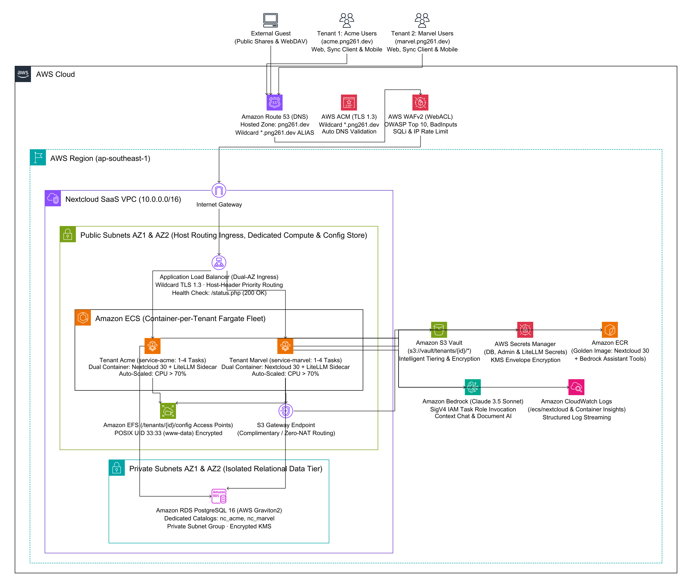

# Nextcloud Multi-Tenant SaaS — Infrastructure as Code

Modular CloudFormation architecture for enterprise Nextcloud Multi-Tenant SaaS on AWS. Built with AWS Well-Architected Framework principles, automated CI/CD pipelines, and zero-NAT cost optimization.

---

## 1. Architecture Overview



The infrastructure delivers:

- **Independent Tenant Compute Tier (Container-per-Tenant Isolation):** Every tenant operates in a dedicated, isolated Amazon ECS Fargate container (`service-<tenant_id>`) with its own runtime lifecycle. Suspending a tenant scales `desiredCount: 0` for instant FinOps zero compute cost while retaining all configuration and data.
- **Host-Header Dynamic Routing:** Traffic is routed at the Application Load Balancer via Host-Header routing rules (`<tenant_id>.domain.com` ➔ `tg-<tenant_id>` ➔ `service-<tenant_id>`).
- **Dual-Container Task:** Nextcloud 30 Apache paired with a local LiteLLM Bedrock Bridge sidecar proxying Claude 3.5 Sonnet foundation models on Amazon Bedrock.
- **3-Tier Storage & Data Tier:**
  - **Amazon EFS:** Encrypted shared persistent config volume mounting dedicated per-tenant Access Points (`/tenants/<tenant_id>/config` to `/var/www/html/config`, NFS 2049, POSIX UID/GID 33 `www-data`), completely siloing runtime configuration and encryption keys.
  - **Amazon S3:** Multi-Tenant Vault Bucket for tenant files with isolated prefixes (`tenants/<tenant_id>/`) and lifecycle transition rules to Standard-IA and Glacier.
  - **Amazon RDS PostgreSQL 16:** AWS Graviton2 cluster with dedicated per-tenant physical databases (`nc_<tenant_id>`).
- **Zero-NAT Lean Networking:** 2-AZ VPC with public subnets for ingress/compute and private subnets for database. Direct S3 access is routed through a complimentary S3 Gateway VPC Endpoint, eliminating NAT Gateway hourly fees (~$44/mo active, ~$19.50/mo idle).
- **Native Control Plane:** Amazon DynamoDB Tenant Registry, AWS Systems Manager (SSM) Automation Runbook (`Tenant-Lifecycle-Operator`), and Amazon CloudWatch Dashboard with real-time operational widgets.

---

## 2. Directory Structure

```
infra/
├── modules/
│   ├── 01-networking/          # VPC, 2 Public & 2 Private Subnets, Route Tables, S3 Gateway Endpoint
│   ├── 02-security/            # ALB, ECS Fargate, RDS PostgreSQL, and EFS Security Groups
│   ├── 03-storage/             # S3 Multi-Tenant Vault Bucket & Amazon EFS Persistent Config Store
│   ├── 04-database/            # RDS PostgreSQL 16 (Graviton2), DB Subnet/Parameter Groups, Secrets Manager
│   ├── 05-compute/             # ALB Host Ingress, ECS Fargate Cluster, Default Fallback Service, ECR, IAM
│   ├── 06-control-plane/       # DynamoDB Tenant Registry, SSM Lifecycle Runbook, CloudWatch Dashboard
│   └── tenant-instance/        # Standalone CloudFormation module for dedicated container-per-tenant provisioning
├── environments/               # Per-environment parameter overrides
│   ├── dev.json
│   ├── staging.json
│   └── prod.json
└── root.yaml                   # Root Nested Stack orchestrator for 1-command bootstrap
```

---

## 3. Modular Architecture Breakdown

The infrastructure is decoupled into **6 autonomous modules** organized by lifecycle and change frequency:

| Layer  | Module                                                   | Key Resources                                                                        | Lifecycle / Change Frequency     |
| ------ | -------------------------------------------------------- | ------------------------------------------------------------------------------------ | -------------------------------- |
| **01** | [`01-networking`](modules/01-networking/README.md)       | VPC, 2 Public Subnets, 2 Private Subnets, IGW, S3 Gateway Endpoint                   | Low (Infrequent updates)         |
| **02** | [`02-security`](modules/02-security/README.md)           | ALB SG, ECS SG, RDS SG, EFS SG (defense-in-depth chaining)                           | Low (Security policy changes)    |
| **03** | [`03-storage`](modules/03-storage/README.md)             | S3 Vault Bucket & Amazon EFS FileSystem with Mount Targets & Access Point            | Very Low (Retain on delete)      |
| **04** | [`04-database`](modules/04-database/README.md)           | RDS PostgreSQL 16.10 (`db.t4g.micro`), Secrets Manager credentials                   | Low (Snapshot on delete)         |
| **05** | [`05-compute`](modules/05-compute/README.md)             | ALB, ECS Fargate, Nextcloud + LiteLLM sidecar, EFS mount `/config`, AutoScaling, ECR | High (App deployments & scaling) |
| **06** | [`06-control-plane`](modules/06-control-plane/README.md) | DynamoDB Tenant Registry, SSM Automation Runbook, CloudWatch Dashboard               | Medium (Operations & monitoring) |

---

## 4. Inter-Module Contract & Discovery

Modules publish their configuration to **AWS Systems Manager (SSM) Parameter Store** under `/nextcloud/${EnvironmentName}/...`, enabling loose coupling without rigid CloudFormation stack export locks:

| Module             | Published SSM Parameters                                                                                                                                                                                                   |
| ------------------ | -------------------------------------------------------------------------------------------------------------------------------------------------------------------------------------------------------------------------- |
| `01-networking`    | `/infra/vpc-id`, `/infra/public-subnets`, `/infra/private-subnets`                                                                                                                                                         |
| `02-security`      | `/security/alb-sg-id`, `/security/ecs-sg-id`, `/security/db-sg-id`, `/security/efs-sg-id`                                                                                                                                  |
| `03-storage`       | `/infra/s3-vault-bucket`, `/infra/s3-vault-bucket-arn`, `/infra/efs-id`, `/infra/default-access-point-id`                                                                                                                  |
| `04-database`      | `/infra/db-endpoint`, `/infra/db-secret-arn`                                                                                                                                                                               |
| `05-compute`       | `/infra/alb-dns`, `/infra/ecs-cluster-name`, `/infra/ecs-service-name`, `/infra/ecs-task-role-arn`, `/infra/ecs-task-execution-role-arn`, `/app/admin-user`, `/app/trusted-domains`, `/ai/enabled`, `/ai/bedrock-model-id` |
| `06-control-plane` | `/infra/tenant-registry-table`, `/infra/ssm-operator-role-arn`                                                                                                                                                             |

---

## 5. Deployment Options

### Option A: CI/CD via GitHub Actions (Recommended)

All deployments are managed using GitHub Actions with AWS OIDC federation:

- **Manual On-Demand Dispatch (`workflow_dispatch`):**
  1. Open GitHub **Actions** ➔ **`Deploy Infra`** ([`.github/workflows/deploy.yml`](../.github/workflows/deploy.yml)).
  2. Select target environment (`dev`, `staging`, `prod`).
  3. Select action:
     - `deploy-module` (updates a single layer, e.g. `compute`, without touching DB or network)
     - `deploy-all` (sequentially deploys modules 01 through 06)
     - `deploy-nested` (packages and deploys `root.yaml` via AWS CloudFormation nested stacks)
     - `destroy-module` / `destroy-all` (tears down resources in reverse dependency order)

### Option B: Unified Deployment Script (`scripts/deploy.sh`)

The repository includes an interactive and scriptable CLI runner in [`scripts/deploy.sh`](../scripts/deploy.sh):

```bash
# Validate all CloudFormation templates
./scripts/deploy.sh --validate

# Deploy a single module (e.g. 05-compute)
./scripts/deploy.sh --module compute --env prod

# Deploy all 6 modules sequentially
./scripts/deploy.sh --all --env prod

# Package and deploy Root Nested Stack
./scripts/deploy.sh --nested --s3-bucket <your-cfn-templates-bucket> --env prod

# Tear down infrastructure in reverse dependency order
./scripts/deploy.sh --destroy-all --env prod
```

### Option C: AWS CLI Direct Commands

```bash
# Deploy a single module (e.g. 01-networking)
aws cloudformation deploy \
  --template-file infra/modules/01-networking/template.yaml \
  --stack-name prod-nextcloud-01-networking \
  --capabilities CAPABILITY_NAMED_IAM \
  --parameter-overrides EnvironmentName=prod

# Package and deploy Root Nested Stack
aws cloudformation package \
  --template-file infra/root.yaml \
  --s3-bucket <your-cfn-templates-bucket> \
  --output-template-file packaged.yaml

aws cloudformation deploy \
  --template-file packaged.yaml \
  --stack-name prod-nextcloud-root \
  --capabilities CAPABILITY_NAMED_IAM CAPABILITY_AUTO_EXPAND \
  --parameter-overrides \
      EnvironmentName=prod \
      AdminPassword="<ADMIN_PASSWORD>" \
      DBPassword="<DB_PASSWORD>"
```

---

## 6. GitHub Actions OIDC Authentication

The project uses AWS IAM OpenID Connect (OIDC) federation, eliminating static AWS access keys:

- **IAM Role:** `arn:aws:iam::123456789012:role/nextcloud-github-actions-deploy-role`
- **Trust Condition:** Restricted to `repo:FilestoreCloud/aws_nextcloud:*`
